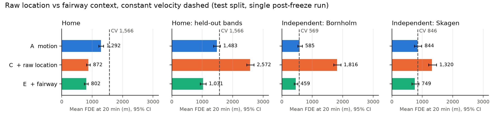
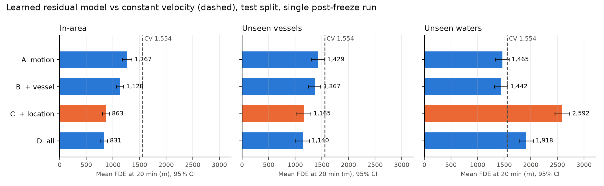

# MORVA

**Context-aware vessel manoeuvre prediction from AIS, with reproducible baselines, manoeuvring-regime analysis and
explicit generalisation tests, including transfer to independent waterways.**

MORVA (Maritime Operational Reasoning and Vessel Analytics) is an independent maritime machine-learning research project. It asks a focused question:

> When do vessel and geographic context improve 5–20-minute trajectory prediction beyond constant-motion and
> motion-only learned baselines, and do those improvements transfer to unseen vessels and unseen waters?

The short answer so far: raw coordinates give strong local accuracy but negative geographic transfer (V1). Fairway
context learned from historical traffic reverses this failure, improving prediction over motion-only models in the
training area and in two independently evaluated Danish waterways (V2). How geography is represented, not merely
whether it is present, determines transfer.

The project combines AIS data engineering, geospatial processing, interpretable kinematic models, residual machine
learning and leakage-aware evaluation. It is an offline research prototype, not a real-time or safety-certified
navigation system.

## Why this problem matters

AIS reports where a vessel is, how fast it is moving and its course over ground. It does not directly reveal why the
vessel is manoeuvring or when the manoeuvre will end. A turn can continue, settle onto a new course, follow a fairway
bend or lead into a terminal approach.

This creates a useful modelling question. Recent motion provides a strong short-term baseline, while vessel type,
dimensions and location may contain additional information. Those same variables can also create shortcuts: vessel
attributes may identify recurring services, and raw coordinates may let a model memorise local routes. MORVA
therefore evaluates both predictive accuracy and transfer.

## Study at a glance

| Item | V1 | V2 |
|---|---|---|
| Data | Danish Maritime Authority historical shore-based AIS, Class A | same |
| Period | 19 Sep–6 Oct 2026 (18 days) | 19 Sep–15 Oct 2026 (27 days) |
| Split | train 19–30 Sep; validation 1–3 Oct; test 4–6 Oct | train 19–30 Sep; validation 1–6 Oct; test 7–15 Oct |
| Training area | Home: Great Belt, Øresund, southern Kattegat | Home only |
| Evaluation settings | Home; home with unseen vessels; home with held-out longitude bands | V1 settings plus two independent waterways |
| Prediction task | 20-minute history → 20-minute future at one-minute resolution | same |
| Baselines | Persistence, CV, CTRV, damped CTRV, CV Kalman filter | same |
| Learned model | Gradient-boosted residual correction to constant velocity | same model and hyperparameters in every region |
| Feature sets | A motion; B + vessel; C + raw location; D all | adds E motion + fairway; F motion + vessel + fairway |
| Hypotheses | V1-H1 to V1-H4b, frozen 11 Oct | V2-H1, V2-H2, frozen 21 Oct, plus two pre-test amendments |
| Metrics | ADE, FDE and horizon errors with vessel-grouped bootstrap intervals | same |

V2 regions and prediction windows (vessels in brackets):

| Region | Box | Training period (19–30 Sep) | Validation (1–6 Oct) | Test (7–15 Oct) |
|---|---|---:|---:|---:|
| Home | 54.8–56.2° N, 10.4–13.0° E | 238,829 (1,535), used for training | 120,412 (1,048) | 167,533 (1,209) |
| Independent waterway: Bornholm | 54.7–55.6° N, 14.0–15.6° E | 80,760 (1,147), map only | 41,675 (752) | 55,561 (904) |
| Independent waterway: Skagen | 57.2–58.0° N, 9.6–11.2° E | 156,175 (1,310), map only | 67,809 (797) | 97,396 (1,011) |

The fairway context uses no external chart or fairway dataset: each region's flow map is built from that region's own
DMA AIS in the training period. Bornholm and Skagen were chosen on 18 October from a one-day traffic check on
training-period data, before any model was run on them; their windows are never used to fit a model. The nine V2 test
days were downloaded after the V2 split was set, and no model results on them were inspected before the V2 freeze.

## Main result: the representation of geography determines transfer



Raw coordinates produce strong local accuracy but negative geographic transfer. Fairway-relative context reverses this
failure: it improves FDE@20 over motion-only prediction in the home area and in two independent waterways.

Mean FDE@20 on the locked V2 test period (7–15 October). Every model is trained on the home area only:

| Model | Home: chronological test | Home: held-out longitude bands | Independent waterway: Bornholm | Independent waterway: Skagen |
|---|---:|---:|---:|---:|
| Constant velocity | 1,566 m | 1,566 m | 569 m | 846 m |
| A: motion only | 1,292 m | 1,483 m | 585 m | 844 m |
| C: + raw location | 872 m | 2,572 m | 1,816 m | 1,320 m |
| E: + fairway context | 802 m | 1,031 m | **459 m** | 749 m |
| F: + vessel + fairway | **768 m** | **1,030 m** | 470 m | **740 m** |

Medians, 90th percentiles and all paired differences are in [docs/06_results.md](docs/06_results.md).

Both frozen V2 hypotheses were supported by the single test run:

1. **V2-H1, fairway context:** E improves on motion-only A by 490 m at home, 127 m in Bornholm and 95 m in Skagen
   (paired 95% CIs all below zero). The improvement is similar when every evaluated vessel is removed from training,
   and it is 452 m in held-out longitude bands.
2. **V2-H2, raw-coordinate negative transfer:** C is worse than A by 1,231 m in Bornholm and 476 m in Skagen (CI lower
   bounds above zero). Before the test run, this decision rule was strengthened from "C does not reduce error" to
   "the CI lower bound of C − A exceeds zero"; the conclusion is the same under the original rule.

Further observations:

- **Bornholm:** motion-only learning does not beat constant velocity, but fairway context does (E − CV −110 m, 95% CI
  −144 to −86). The result is consistent with fairway context reducing large errors in predominantly straight
  transit, rather than proving a particular causal mechanism.
- **Regimes:** E improves on A in every manoeuvring regime and setting, except Skagen low-speed, where there is no
  detectable difference (+9 m, CI −15 to +32).
- **Seeds:** the hypotheses were decided on the prespecified seed 0; seeds 0–2 are a sensitivity check. A and E vary by
  at most 2 m across seeds, while C is unstable in the waterways (Bornholm 1,816 / 1,816 / 2,218 m).
- **Exploratory:** at home, E's mean error is 70 m lower than C's. This was not a prespecified comparison.

Fairway-relative context retained predictive value in two independently evaluated Danish waterways. Whether it does so
in other countries, seasons and waterway types is untested. The hypotheses, both pre-test amendments and every test
command are recorded in the [protocol](docs/05_protocol.md) and [research log](docs/08_research_log.md).

## V1 result: raw location helps in familiar waters only



Mean final displacement error at 20 minutes on the 57,068-window V1 test period (4–6 October):

| Model | Home | Home: unseen vessels | Home: held-out longitude bands |
|---|---:|---:|---:|
| Constant velocity | 1,554 m | 1,554 m | 1,554 m |
| A: motion only | 1,267 m | 1,429 m | 1,465 m |
| B: + vessel attributes | 1,128 m | 1,367 m | 1,442 m |
| C: + raw location | 863 m | 1,165 m | 2,592 m |
| D: all features | **831 m** | **1,140 m** | 1,918 m |

Four conclusions defined V1:

1. **Constant velocity is a strong baseline.** Ordinary CTRV is 467 m worse at 20 minutes; damped CTRV and the
   constant-velocity Kalman filter converge to approximately the CV result.
2. **Motion-only learning helps most during non-steady behaviour.** The test improvement over CV is 88 m during
   steady transit, 316 m while turning and 1,078 m during combined turning and speed change.
3. **Raw location is highly predictive inside familiar waters.** The full model reduces in-area FDE@20 by 47%, and
   the benefit survives when every test vessel is removed from training.
4. **Raw location does not transfer to held-out longitude bands.** Spatial hold-out reverses the gain: location is
   1,127 m worse than motion alone (V1-H4 rejected, V1-H4b supported). The in-area model learned useful but
   geographically attached route corrections.

The negative transfer result motivated V2. High in-area accuracy does not demonstrate transferable geographic
understanding.

## Research design

### Leakage-aware windows

AIS messages are irregular. MORVA segments tracks, resamples them to one-minute intervals and rejects a prediction
window if any original reporting gap inside its history or future exceeds 180 seconds. Windows never cross the
train/validation/test boundaries.

### Transparent baselines

- **Persistence:** remain at the last observed position.
- **Constant velocity (CV):** continue with the latest speed and course.
- **CTRV:** continue with the recent speed and turn rate.
- **Damped CTRV:** decay the recent turn rate over the forecast horizon.
- **CV Kalman:** estimate position and velocity using a linear Kalman filter.

Baseline parameters are selected using training data only.

### Residual prediction

The learned model starts from the CV trajectory and predicts an along-track and cross-track correction in the vessel's
local body frame. Corrections are estimated at 5, 10, 15 and 20 minutes and interpolated between those knots.

The four controlled feature sets are:

- **A — motion:** recent speed, speed change, course change, course jitter and past relative positions;
- **B — vessel:** A plus vessel group, length, beam and draught;
- **C — location:** A plus latitude, longitude and course orientation;
- **D — all:** motion, vessel and location features.

V2 adds two feature sets that use historical traffic instead of coordinates:

- **E — fairway:** A plus fairway context (below);
- **F — vessel + fairway:** A plus vessel attributes and fairway context.

Holding the learner and samples fixed makes it possible to attribute changes to the added information rather than to a
different model architecture.

### Fairway context from historical traffic (V2)

For each waterway, a flow map summarises where and in which direction moving vessels (≥ 3 kn) sailed during the
training period, from that waterway's own AIS: a 300 m grid with 12 course bins. No external chart or fairway dataset
is used. A query pools a 1.5 km block and only traffic heading the same way, so the
opposite lane of a traffic separation scheme is ignored. Fourteen features describe the vessel's relation to that
flow: traffic density, flow coherence, heading and lateral offset from the lane and lane width at the vessel; and the
lane's heading, offset and density at the constant-velocity positions 5, 10 and 20 minutes ahead. None of them uses
absolute position.

A training window gets a map without the day(s) its own future covers, so it can never see its own path. The map of
an independent waterway comes from that waterway's historical traffic; the model's weights never see the waterway.
Method details, including how junctions and missing coverage are handled, are in [docs/04_methods.md](docs/04_methods.md).

### Past-only manoeuvring regimes

Every sample is classified from the last 10 minutes of observed history:

| Regime | Past-only definition |
|---|---|
| Low-speed | Mean SOG below 5 kn |
| Steady | At least 5 kn, turn below 1°/min, speed change below 2 kn |
| Turning | At least 5 kn, turn at least 1°/min, speed change below 2 kn |
| Speed-changing | At least 5 kn, turn below 1°/min, speed change at least 2 kn |
| Combined | At least 5 kn, turn at least 1°/min, speed change at least 2 kn |

The regime analysis includes alternative thresholds and a position-derived turn check. Context variables are not part
of the regime definition, so their contribution can be measured within each motion state.

### Generalisation tests

- **Chronological test:** later whole-day time block.
- **Vessel-held-out:** every evaluation vessel is removed from training, with a same-size random-subset control.
- **Spatially held-out:** each longitude band is predicted by a model trained outside that band with a buffer.
- **Independent waterways (V2):** Bornholm and Skagen are processed with the same pipeline but never used for
  training; each is evaluated separately.
- **Multiple seeds:** learned models are repeated with seeds 0–2.

Paired error differences use identical windows. Confidence intervals resample whole vessels because overlapping
windows from one vessel are not independent.

## Reproducible pipeline

```text
raw DMA ZIP/CSV + checksummed manifests
  → ingest: AOI and Class A filtering, schema conversion, exact de-duplication
  → quality: sentinel normalisation, flags and quality report
  → tracks: gap-based segmentation and vessel metadata
  → windows: one-minute resampling, gap-safe histories/futures, chronological split
  → baselines: persistence, CV, CTRV, damped CTRV and CV Kalman
  → fairway (V2): traffic-flow maps from the training period and fairway features per window
  → learning: residual GBM with motion/vessel/location/fairway ablations
  → evaluation: horizon metrics, paired differences, grouped confidence intervals
  → analysis: regimes, vessel hold-out, spatial hold-out and sensitivity tests
```

Raw data are not committed. Manifests record filenames, checksums and provenance; derived aggregate tables and figures
are versioned.

## Quick start

Requirements: Python 3.12 and [uv](https://docs.astral.sh/uv/).

```bash
uv sync
uv run pytest
make smoke
```

`make smoke` runs the complete pipeline in an isolated synthetic workspace, so synthetic artifacts cannot be mixed
with real experiment outputs.

To process DMA data:

```bash
uv run morva manifest data/raw/aisdk-YYYY-MM-DD.zip --notes "..."
make pipeline
uv run morva fairway
uv run morva gbm
uv run morva gbm --split transfer_val --region bornholm
```

V2 outputs are written to `results/v2/` (set by `results_dir` in `configs/experiment.yaml`); V1 outputs stay in
`results/`. The `test` and `transfer_test` splits are protected by `--confirm-test`. Both the V1 and the V2 test
periods have been used once for their recorded runs and must not be used for further model development.

## Technology

- **Python 3.12**
- **Polars, PyArrow and Parquet** for large tabular AIS processing
- **NumPy** for trajectory tensors, geometry and vectorised baselines
- **scikit-learn** for histogram gradient boosting
- **DuckDB** for local analytical queries
- **Matplotlib** for research figures
- **PyYAML** for configuration-driven experiments
- **pytest** and **Ruff** for verification and static checks
- Optional **PyTorch** dependency for future sequence-model experiments

## Repository structure

| Path | Purpose |
|---|---|
| `src/morva/ingestion/` | DMA ingestion, manifests and synthetic data |
| `src/morva/quality/` | Sentinel normalisation and quality flags |
| `src/morva/trajectories/` | Track segmentation and vessel metadata |
| `src/morva/features/` | Windows, motion features and regimes |
| `src/morva/models/` | Kinematic baselines, Kalman filter and residual GBM |
| `src/morva/evaluation/` | Splits, metrics and grouped uncertainty |
| `src/morva/viz/` | Maps and result visualisations |
| `configs/` | Data and experiment configuration |
| `docs/` | Problem, literature, methods, protocol, results and limitations |
| `paper/` | Preliminary research summary |
| `results/` | Versioned tables, figures and run summaries |
| `tests/` | Geodesy, quality, segmentation, window, model and regime tests |

## Documentation

- [Problem statement and motivation](docs/01_problem.md)
- [Literature position](docs/02_literature.md)
- [Data card and terms](docs/03_data_card.md)
- [Methods](docs/04_methods.md)
- [Protocol and hypothesis provenance](docs/05_protocol.md)
- [Validation and test results](docs/06_results.md)
- [Limitations](docs/07_limitations.md)
- [Research log](docs/08_research_log.md)
- [Preliminary research summary](paper/preliminary_summary.md)

## Scope and limitations

The results cover 27 days of autumn traffic, Class A transmitters and Danish waters only. V2 adds two independent
waterways, but both are Danish and share part of their traffic with the training area. The learned comparison uses one
model family and deterministic outputs. Fairway context needs historical traffic for the waterway, so it does not
apply to waters without AIS history. AIS omits control commands, route intent and several environmental and
interaction variables.

MORVA does not provide collision avoidance, infer intent, certify anomalies or replace radar, bridge judgement or
VTS procedures. See the full [limitations](docs/07_limitations.md).

## Next research steps

1. Test fairway context across seasons, in non-Danish waters and with sparser traffic history.
2. Add chart-based context that does not need traffic history: coastline, bathymetry and port proximity.
3. Add calibrated uncertainty and multiple plausible future trajectories, especially near junctions.
4. Model surrounding-vessel interactions under the same controlled evaluation.
5. Evaluate prediction residuals for anomaly screening only after defining credible labels and operational criteria.

## Data access

Historical AIS files are available from the
[Danish Maritime Authority](https://www.dma.dk/safety-at-sea/navigational-information/ais-data). Raw files are not
redistributed here. The [data card](docs/03_data_card.md) records the study selection, observed quality, source terms
and known biases.

## Licence

Code is released under the [MIT License](LICENSE). DMA AIS data is not included and remains subject to the provider's
terms.
